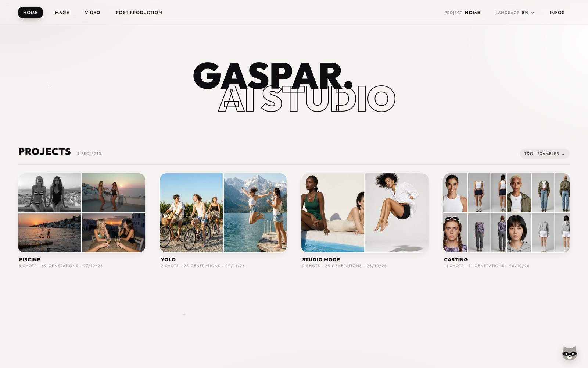
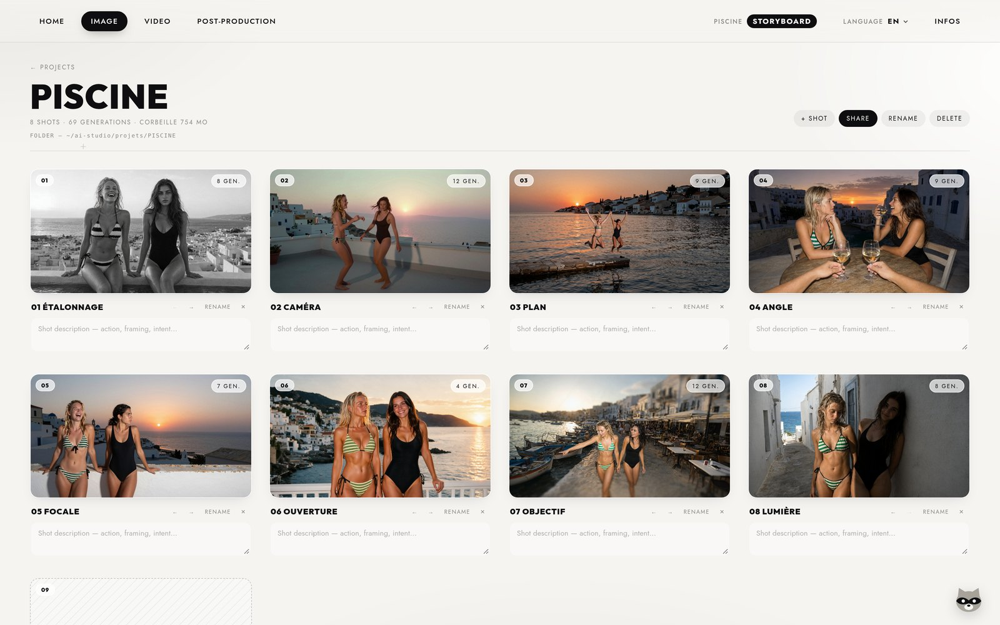
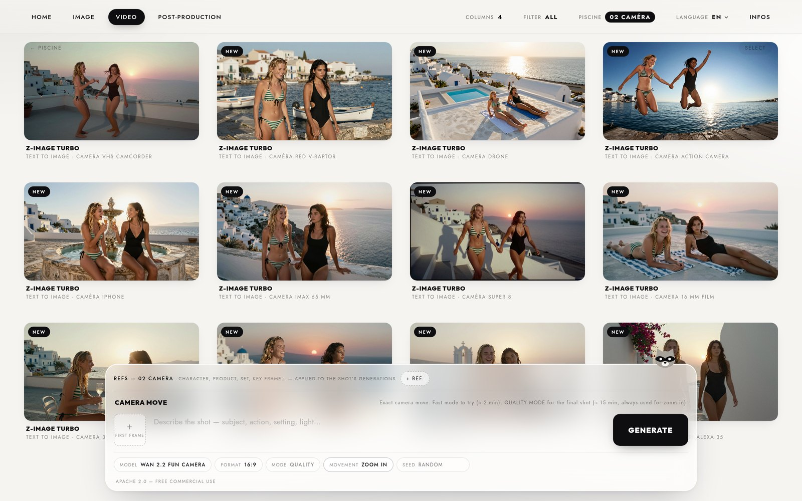
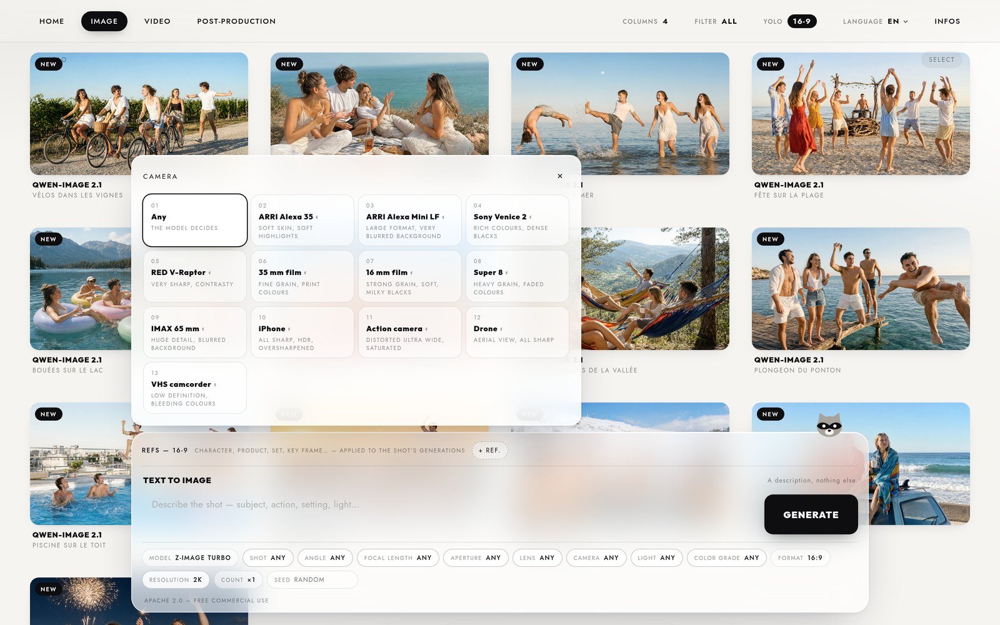
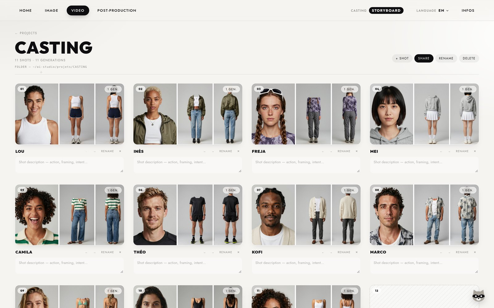
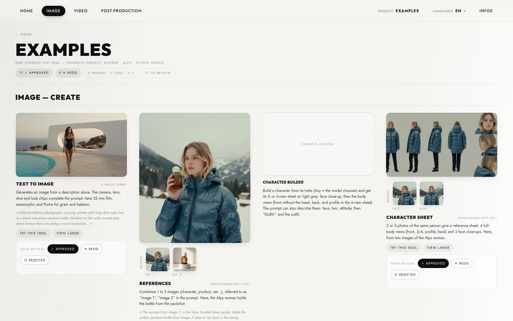
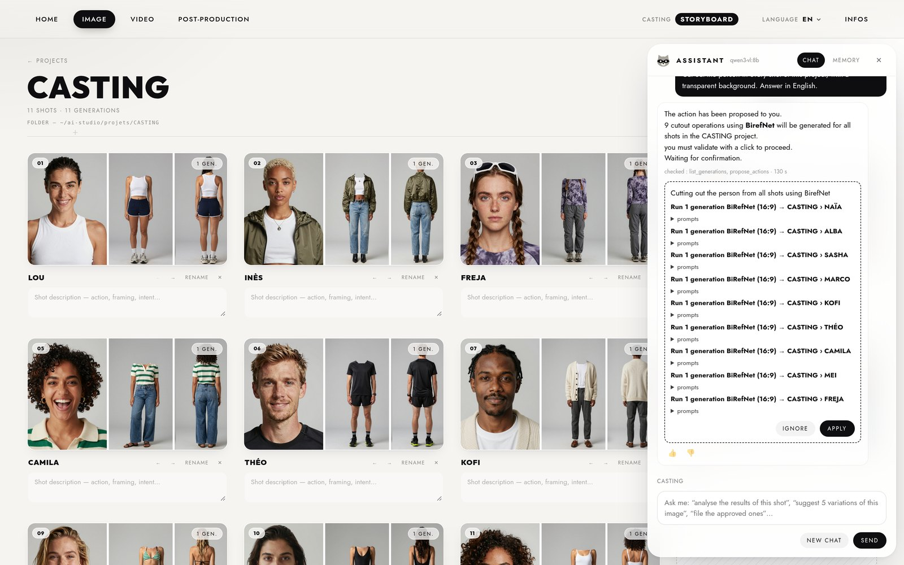
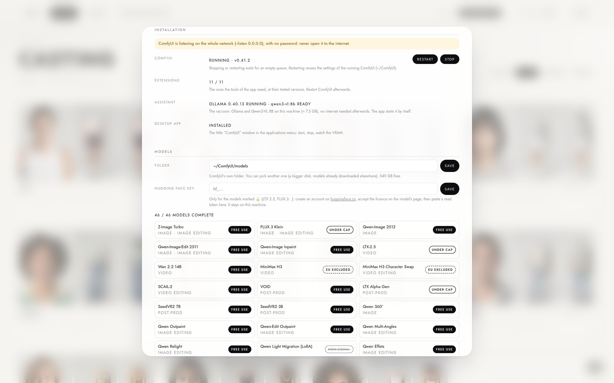

# AI STUDIO — Gaspar Matheron

Interface de génération image et vidéo façon Higgsfield, branchée sur un
ComfyUI local. Sa direction artistique (titres en MADE Outer Sans) est celle de l'auteur ; cette police
commerciale n'est pas incluse, voir **Licences**.
**41 outils, 42 modèles**, en 5 espaces : IMAGE, RETOUCHE IMAGE, VIDÉO,
RETOUCHE VIDÉO, POST-PRODUCTION. Tout tourne sur la machine : aucun appel à une
API, aucun nœud de service en ligne dans les graphes.

> **A web app that drives local ComfyUI: image & video tools with film-style controls, all offline.**

## Démo

[](docs/demo.mp4)

*Cliquer sur l'image pour lancer la vidéo (1 min 58, son pendant le dialogue).* Images, animation d'une photo,
une même prise transformée de plusieurs façons, dialogue, projets et plans, direction photo, vue d'ensemble des
outils, assistant local.

| | |
|---|---|
|  **Projets** |  **Un projet = un storyboard de plans** |
|  **Chaque plan, son bac à sable de prises** |  **Direction photo : caméra, optique, lumière…** |
|  **Personnages cohérents** |  **Tous les outils, avec un exemple** |
|  **L'assistant propose, tu valides** |  **Installation et ComfyUI depuis l'app** |

## Installer (Linux + carte NVIDIA, sans sudo)

```bash
git clone https://github.com/gasparmb/gaspar-ai-studio-comfy.git && cd gaspar-ai-studio-comfy && ./installer.sh
```

Installe ce qui manque, aux versions testées : ComfyUI et PyTorch pour CUDA, les 11 extensions de ComfyUI dont les
outils ont besoin, l'assistant local (Ollama + Qwen3-VL 8B, ≈ 7,5 Go en tout) et la petite app de bureau qui démarre
et arrête ComfyUI ; puis démarre ComfyUI et AI STUDIO. Crée le premier compte (l'administrateur) depuis la machine
elle-même, sur `http://127.0.0.1:8190`. Les modèles se téléchargent ensuite dans **INFOS › MODÈLES** (dossier au
choix, liens officiels, empreintes vérifiées ; une clé Hugging Face pour LTX 2.5 et FLUX.3). **INFOS ›
INSTALLATION** montre l'état de chaque partie, complète ce qui manque et démarre / arrête / relance ComfyUI.
Il faut `git`, `curl`, `ffmpeg`, `zstd`, `python3-venv` (et `python3-tk` pour la petite app).

## Lancer

```bash
./lancer.sh
```

Puis ouvrir `http://127.0.0.1:8190`. ComfyUI doit tourner sur le port 8188. Depuis un autre appareil du réseau
local, utiliser l'adresse IP de la machine sur le port 8190 (voir ci-dessous).

## ⚠ Accès et réseau

- L'app écoute par défaut sur **tout le réseau local** (`HOST=127.0.0.1` pour la réserver à la machine).
- Elle demande un compte, **sauf pour les requêtes venues de la machine elle-même** (127.0.0.1, outils en ssh ;
  `AUTH_LOCAL_BYPASS=0` pour l'enlever). Donc : **ne jamais publier le port 8190** sur internet, ni derrière un
  tunnel ni derrière un reverse proxy — ils arrivent eux aussi par 127.0.0.1.
- Le seul port publiable est le **8191**, le site des liens clients (`share.py`), qui ne sert qu'un projet par jeton.
- Premier compte = administrateur, et il ne peut se créer que depuis la machine elle-même. Les suivants demandent
  un accès, que l'administrateur accepte dans **COMPTES**.

## Ce que fait l'interface

- **IMAGE / VIDÉO / POST-PRODUCTION**, puis un outil (menus du haut) :
  - **Texte** : le prompt seul · **1re image**, **1re + dernière** · **Références** (1 à 3 images)
  - édition d'image (consigne, inpaint, étendre le cadre, angle de caméra, relight, effets…),
    édition vidéo (changer la tenue, l'objet, le décor, le personnage, doubler…),
    post-prod (upscale, ralenti, HDR, détourage, atmosphère…).
- **Puces de réglage** : modèle, DIRECTION PHOTO (plan, angle, focale, ouverture, objectif, caméra, lumière,
  étalonnage), format, résolution, durée, nombre de variantes, mode qualité, seed, et les puces propres à
  chaque outil. Une puce sans effet sur le modèle choisi n'est pas affichée.
- **Composition du prompt** : les réglages sont traduits en texte et assemblés autour de ta description. Le prompt
  final est visible dans la visionneuse.
- **Personnages `@prénom` et lieux `@lieu`** : une planche de personnage ou une image gardée sous un nom
  devient appelable dans le prompt — même visage, même décor, d'un plan à l'autre.
- **File d'attente** : ce qui calcule et ce qui attend, tous projets confondus, avec annulation.
- **Bilan par modèle** : ce que tes avis disent de chaque modèle et sur quels outils (menu du compte).
- **Projets → plans** : chaque média vit dans le dossier de son plan ; références par plan, storyboard, avis
  (validée / à refaire / rejetée), corbeille par projet.
- **Liens clients** : un lien par client et par projet, trois niveaux (voir, commenter, accès complet), servis par
  un second site (port 8191), publiable par un tunnel si besoin.
- **Assistant local** (le raton laveur) : lit les projets, regarde les images, propose des actions
  que tu valides d'un clic. Tout reste sur la machine (Ollama).
- **Bilingue** français / anglais (menu LANGUE).

## Fichiers

| Fichier | Rôle |
|---|---|
| `server.py` | Serveur aiohttp (port 8190) : interface, relais de l'API ComfyUI, websocket de progression, historique, projets |
| `pipelines.py` | Transforme une demande en graphe ComfyUI à partir des templates officiels |
| `catalog.json` | Modèles, méthodes, options (caméras, optiques, plans, lumières, étalonnages…) : **à éditer librement** |
| `folders.py` | Rangement des projets sur le disque (`projets/<PROJET>/<PLAN>/`), noms des fichiers, corbeille |
| `auth.py` | Comptes, sessions, contrôle d'accès ; page `/login` |
| `share.py` | Site des liens clients (port 8191), le seul publiable |
| `assistant.py` | Assistant local (Ollama + Qwen3-VL), outils de lecture, propositions à valider, mémoire |
| `modeles.py`, `models_manifest.json` | INFOS › MODÈLES : fichiers de chaque modèle, liens officiels, téléchargements |
| `installation.py`, `installer.sh` | Installation (ComfyUI, extensions, assistant, petite app) et démarrage / arrêt de ComfyUI |
| `templates/` | Templates Comfy-Org exportés au format API |
| `static/` | Interface (HTML, CSS, JS vanilla, polices) |
| `comfy_nodes/` | Nos nœuds ComfyUI (atmosphère, chorégraphie de caméra, dialogue InfiniteTalk) |
| `docs/` | `PRESENTATION.md` (à quoi sert l'app, et le script de la démo de 2 min) et le savoir de départ de l'assistant |
| `tools/` | Outils et tests (voir plus bas) |
| `.env.example` | Variables d'environnement (port, dossiers, adresses) avec leurs valeurs par défaut |
| `data/jobs.json` | Historique des générations (les fichiers vivent dans `~/ComfyUI/output/`) |
| `data/characters.json`, `data/places.json` | Les `@prénom` et les `@lieu` : un nom et la génération d'où vient l'image |

Les variables d'environnement se passent au lancement (`PORT=8190 ./lancer.sh`) ; l'app ne lit pas de fichier `.env`.

Présentation détaillée et script de démonstration : **[`docs/PRESENTATION.md`](docs/PRESENTATION.md)**.

## Tests

```bash
~/ComfyUI/.venv/bin/python tools/audit_graphs.py        # construit les 77 couples outil × modèle (rien n'est envoyé)
~/ComfyUI/.venv/bin/python tools/test_chemins.py        # aucun fichier cité ne sort des dossiers de ComfyUI
~/ComfyUI/.venv/bin/python tools/test_modeles.py        # INFOS › MODÈLES (téléchargements simulés)
~/ComfyUI/.venv/bin/python tools/test_installation.py   # INFOS › INSTALLATION (rien n'est installé)
PORT=8190 SHARE_PORT=8191 ~/ComfyUI/.venv/bin/python tools/test_share.py   # liens clients, app démarrée
```

`tools/test_auth.py` (comptes) tourne **uniquement sur une instance de test** : mode d'emploi en tête du fichier.

## Ajouter un modèle

1. Exporter son template au format API dans `templates/` (dans ComfyUI : Workflow → Exporter (API)).
2. Ajouter une entrée dans `catalog.json` (`requires` = fichier de modèle, relatif à `~/ComfyUI/models`), puis
   refaire le manifeste sur une machine où tout est installé :
   `~/ComfyUI/.venv/bin/python tools/models_manifest.py --check` (fichiers, liens, extensions).
3. Écrire sa fonction dans `pipelines.py` (repérer les ids de nœuds du prompt, des images, du format et de la
   seed) et l'ajouter à `BUILDERS`.
4. `tools/audit_graphs.py`, puis un vrai essai.

## Licences

**Des modèles** (vérifiées sur Hugging Face, badge sur chaque modèle dans l'app) :

- **Libres** (Apache 2.0 / MIT) : Z-Image Turbo, Qwen-Image 2512, Qwen-Image-Edit 2509 et 2511, Qwen-Layered,
  Wan 2.2 (et Fun Camera, Wan-Move, Animate 2), Wan 2.1 + InfiniteTalk, SCAIL-2, VOID, SeedVR2, BiRefNet, FILM,
  Video Depth Anything Small, LoRAs Multi-Angles, Relight, 360 et INFL8.
- **Gratuits sous un seuil de chiffre d'affaires** : LTX-2.5 et LTX-2.3 (moins de 10 M$/an), FLUX.3 Klein (moins de 5 M$/an).
- **UE exclue** : MiniMax H3 (références, prolonger, Character Swap, VFX Edit) — pas d'usage commercial en France
  sans accord MiniMax.
- **Non commerciaux**, présents mais signalés par un badge et une confirmation : Qwen-Image 2.1 (licence
  recherche), LoRA « Lumière de référence » (licence non déclarée).
- **NVIDIA RTX** : les trois outils qui s'appuyaient sur le SDK propriétaire NVIDIA (upscale rapide, ralenti RTX,
  SDR → HDR) **ne sont plus dans les menus** — l'app n'a donc aucune dépendance propriétaire. Le ralenti reste,
  servi par FILM (Apache 2.0). Pour les retrouver : remettre `"workspaces": ["post"]` sur les modèles `rtx-*` du
  catalogue et installer l'extension avec `python3 installation.py install nodes-nvidia`.

**Du code** : **GNU GPL version 3** (`LICENSE`). Les nœuds de `comfy_nodes/` s'appuient sur le code de ComfyUI,
lui-même en GPL-3 ; le dépôt entier suit la même licence pour rester simple.

**Des polices** : Jost et Outfit (`static/fonts/`) sont sous licence OFL, leurs licences sont à côté des fichiers.
La police de titre d'origine, **MADE Outer Sans**, est commerciale : elle n'est pas incluse dans ce dépôt. Si elle
est installée sur la machine, l'app l'utilise ; sinon elle prend Outfit, et le contour du logo est dessiné par le
navigateur.
